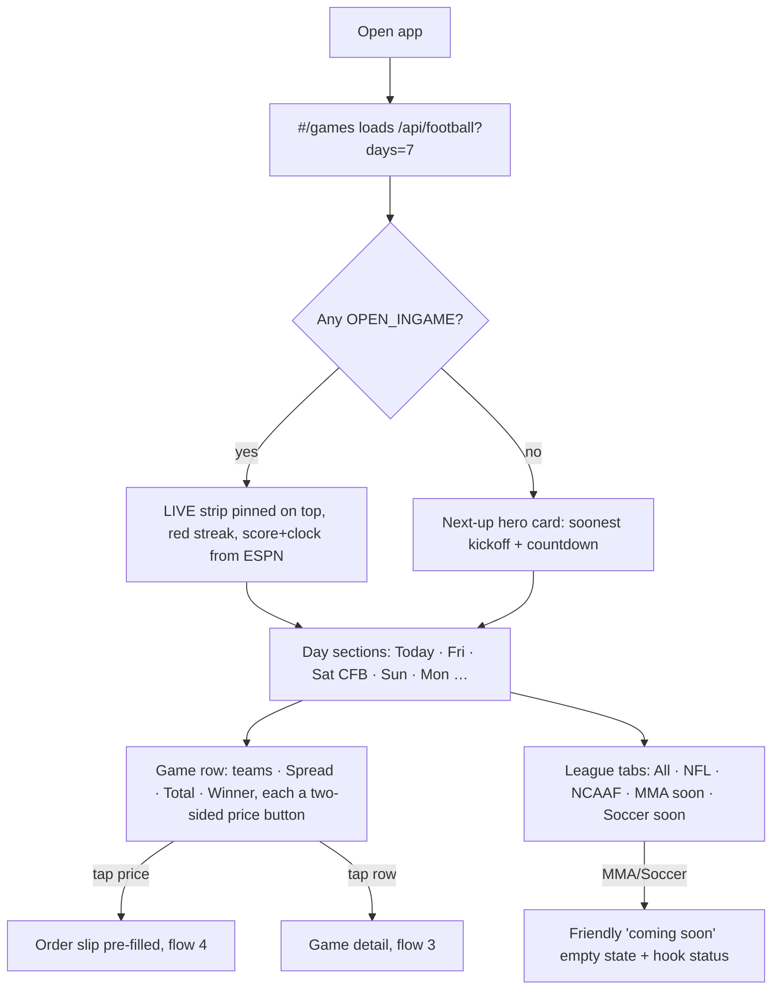
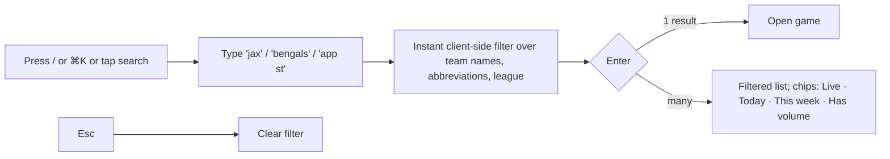
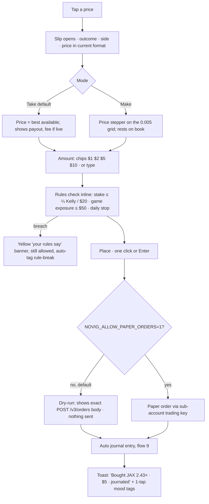
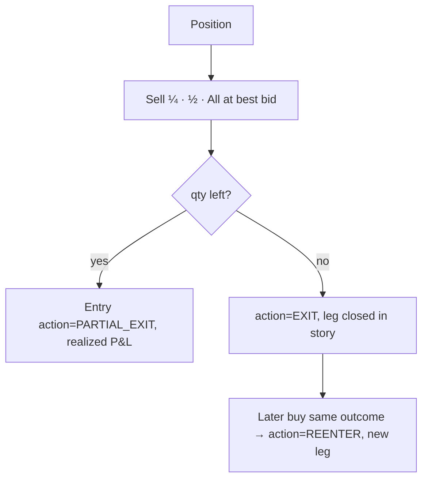
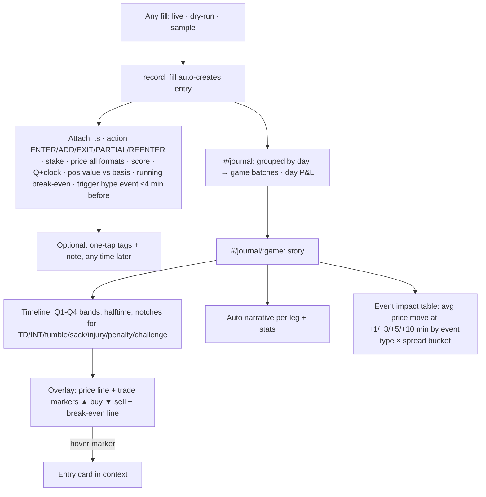

# NOVIG (clean) — User Flows  v0.2
Written **before** any screen was built. Every flow below maps to a hash route in the prototype (`static/index.html`).
Persona: Michael, swing-trades live football on Novig in $1–$5 increments, eyes on numbers, stress high, wants **speed** and **a journal that writes itself**.

## 0. Information architecture
```mermaid
flowchart LR
  subgraph Shell[App shell · always visible]
    TB[Top bar: logo · search ⌘K · balance · price-format chip]
    NAV[Left rail: Games · Positions · Journal · Account · Settings · System]
    SLIP[Order slip drawer: right side, persists across routes]
  end
  NAV --> G[#/games]
  G --> GD[#/game/:eventId]
  GD --> SLIP
  NAV --> P[#/positions]
  P --> GD
  NAV --> J[#/journal]
  J --> JS[#/journal/:gameKey  story + timeline]
  JS --> GD
  NAV --> A[#/account]
  NAV --> S[#/settings]
  NAV --> DS[/system.html  design system sampler]
```
Routes: `#/games?league=&when=&q=` · `#/game/:eventId?tab=lines|props|book` · `#/positions` · `#/journal` · `#/journal/:gameKey` · `#/account?tab=overview|tx|history` · `#/settings`.

## 1. Browse live + upcoming games (now → +7 days)

## 2. Search / filter

## 3. Game detail
```mermaid
flowchart TD
  GD[#/game/:id] --> H[Header: AWAY score — HOME score, red streak, clock/kickoff, volume]
  H --> CH[Price chart: winner line both teams, 1H · 1D · All, trade markers + event notches]
  CH --> LN[Game lines: Spread · Total · Winner as two-sided rows]
  LN -- Alt lines --> ALT[All 60+ markets grouped: Main · 1st Half · Team totals · Props]
  GD --> BK[Order book ladder for the selected market, best bid/ask, depth bars]
  GD --> POS[Your position card: value (Δ vs basis), break-even, rules panel]
  BK -- tap a level --> SL[Slip: Make at that price]
  LN -- tap price --> SL2[Slip: Take best]
```
## 4. Quick bet / order slip — Take vs Make

## 5. Add in small increments ($1 / $2 / $5)
```mermaid
flowchart LR
  POS[Position card or Positions row] --> ADD[+1 · +2 · +5 buttons at best ask]
  ADD --> CONF[No modal: optimistic fill, undo-free because dry-run; live mode asks once per session]
  CONF --> UPD[Card updates: qty, basis, break-even multiplier, value $x.xx (Δ)]
  UPD --> JE[Journal entry action=ADD, linked to latest hype notch]
```
## 6. Exit / partial exit / re-enter

## 7. Open positions monitor
`#/positions`: one row per open outcome, sorted by |Δ|. Columns: game · side · value `$1.12 (−3.82)` · avg × · mark × · break-even × · quick +1/+2/+5 · Sell ½/All. Live from journal + Novig `/v3/portfolio/positions` when the sub-account has any. Red-streak row when a rule trips (time stop, daily stop).

## 8. Account
`#/account`: balance (main + `grok-paper-trading` sub-account), P&L curve from journal, stats (hit rate, avg win/loss, by event type), transactions & transfers (Novig), order + fill history, settled positions. Sample-labelled when Novig returns empty.

## 9. Journal (key feature)

## 10. Settings
Price format: **Multiplier** (default, `2.43 : 1.89`) · Percentage (`41% : 53%`) · Precise Percentage (`41.2% : 52.9%`). Also: default stake chips, rules (stop, exposure, Kelly fraction), data sources status (Novig paper / ESPN / CFBD stub / MMA & Soccer hooks), order mode (dry-run lock, read-only).

---
## Low-fi wireframes (ASCII)
### Games
```
┌ NOVIG▬ ──────────────── [/ search games…            ]  $1,000.00  [2.43:1.89 ▾] ┐
│ Games    │ LIVE ▬▬▬                                                               │
│ Positions│  HOU 17 ▬ 14 JAX   Q2 0:08    Spread  [+2.5 1.92][-2.5 1.96]  Win [..]  │
│ Journal  │ [All][NFL][NCAAF][MMA·soon][Soccer·soon]   [Live][Today][Week]           │
│ Account  │ THURSDAY OCT 22 ─────────────────────────────────────────────────────    │
│ Settings │  5:15p  PIT  @  CIN     Spread [ ][ ]   Total [ ][ ]   Winner [ ][ ]  ›  │
│          │ SATURDAY OCT 24 · COLLEGE ───────────────────────────────────────────    │
└──────────┴──────────────────────────────────────────────────────── [ SLIP ▸ ] ────┘
```
### Game detail
```
│ NFL · WEEK 8 · LIVE                                           Q3 6:42 · VOL $184k │
│ BENGALS 17 ▬▬▬ 20 RAVENS        story/summary sentence                          │
│ ┌ chart ─────────────────────────────── [1H][1D][All] ┐ ┌ YOUR POSITION ───────┐ │
│ │ ╲__/‾‾\__  ▲  ▼    | notches                         │ │ $6.20 (+1.20)         │ │
│ └─────────────────────────────────────────────────────┘ │ BE 2.10× · +1 +2 +5   │ │
│ GAME LINES  [Main][1st Half][Team totals][Props]        │ Sell ½  Sell all      │ │
│ Spread  CIN +3.5 [1.95]  BAL -3.5 [1.91]               ├ YOUR RULES SAY ───────┤ │
│ Total   O 47.5   [1.88]  U 47.5   [1.98]               │ ✓ edge ≥ .03 …        │ │
│ Winner  CIN      [2.43]  BAL      [1.89]               └───────────────────────┘ │
│ BOOK  bid ████ .41 | .42 ███ ask                                                  │
```
### Order slip (drawer)
```
┌ ORDER SLIP ───────── × ┐
│ BAL · Winner           │
│ [ Take ][ Make ]       │
│ Price  1.89×  (52.9%)  │
│ [$1][$2][$5][$10] [__] │
│ Payout $9.45  Fee $0.07│
│ ⚠ your rules say …     │
│ [   Place  ⏎   ]       │
│ dry-run · nothing sent │
└────────────────────────┘
```
### Journal story
```
│ CHI @ ATL · SUN OCT 18 · −$1.63 · 6 fills                                     │
│ ┌ timeline ─ Q1 ──┬── Q2 ──┃HALF┃── Q3 ──┬── Q4 ── ┐                            │
│ │ price  ╲_/‾╲__▲___▼‾‾                              │                         │
│ │ notches ✋ INT  🏈 TD  ⚑ PEN  ✚ INJ                │                         │
│ └────────────────────────────────────────────────────┘                         │
│ Leg 1: bought ATL at 2.78× right after an INT (Q2 13:24) … out at 2.06× +$1.74 │
│ entries: 13:16 ENTER ATL $5 @2.78× (36%) · 7–0 Q2 13:24 · $5.00 (0.00) [tags]  │
```
