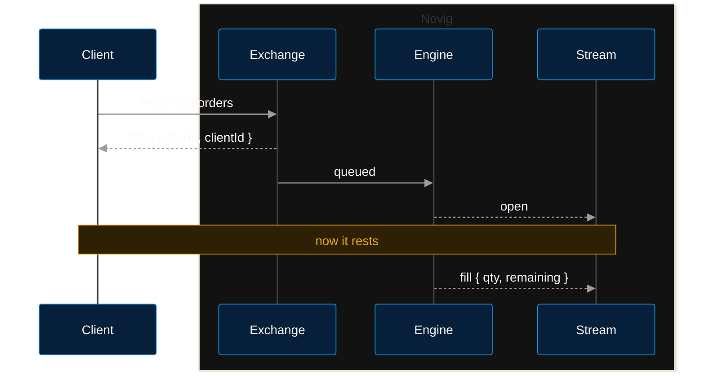

> ## Documentation Index
> Fetch the complete documentation index at: https://docs.novig.com/llms.txt
> Use this file to discover all available pages before exploring further.

# Execution

> Place and cancel orders, and see why a place is not a rest

An order names an outcome, a price and a quantity. A trading key signs it. The order trades that key's subaccount.

| Route | Key | Throttle | Cost | Reply |
| - | - | - | - | - |
| `POST /v3/orders` | `trading` | `place` | `1 /request` | 201 |
| `POST /v3/orders/batch` | `trading` | `place` | `1 /order` | 201 400 422 |
| `DELETE /v3/orders/{id}` | `trading` | `cancel` | `1 /request` | 200 |
| `DELETE /v3/orders/batch` | `trading` | `cancel` | `1 /order` | 200 207 404 |
| `DELETE /v3/orders` | `trading` | `cancel` | `1 /request` | 200 |
| `GET /v3/orders` `GET /v3/orders/{id}` | `trading` `trading::read` | `read` | `1 /request` | 200 |

| Body | Type | | |
| - | - | - | - |
| `outcomeId` | `uuid` | The side. Never a market ID. | **required** |
| `price` | `string` | Probability in $(0,1)$, three places. `"0.665"`, never `0.665`. | **required** |
| `qty` | `int` | Number of contracts. A winning contract pays full value, 1¢. | **required** |
| `tif` | `GTC` `GTT` `IOC` `FOK` `PO` | See below. | **required** |
| `ttl` | `int ms` | Required for `GTT`, optional for `PO`, forbidden otherwise. | |
| `clientId` | `uuid` | A label. Echoed on the answer and on every event. Not an idempotency key. | |

**Request**

```json theme={"dark"}
{ "outcomeId": "3f2504e0-…", "price": "0.665",
  "qty": 110, "tif": "GTC", "clientId": "0b3f5f20-…" }
```

**201**

```json theme={"dark"}
{ "orderId": "7c9e6679-…", "clientId": "0b3f5f20-…" }
```

| `tif` | Behaviour | `ttl` |
| - | - | - |
| `GTC` | Rests until filled or cancelled | forbidden |
| `GTT` | Rests until filled, cancelled, or `ttl` elapses | **required** |
| `IOC` | Fills what it can immediately. Remainder cancelled | forbidden |
| `FOK` | Fills completely and immediately, or not at all | forbidden |
| `PO` | Post only. Rejected instead of taking | optional |

## Retries

`clientId` is a label, not an idempotency key. The exchange echoes it on the answer and on every `open` and `fill`. Use it to match an event to the place that caused it. The exchange never checks it for uniqueness.

| Retry with | Result |
| - | - |
| The same `clientId`, the same body | A second order |
| The same `clientId`, a different body | A second order |
| No `clientId` | A second order |

> [!WARNING]
>
> **A replayed place always places again.** Send each order once. If you lose an answer, read the [private stream](/api/streaming/private) before you resend. Match on `clientId`. No route cancels by `clientId`.

## Batch

A batch is all or nothing. The exchange checks every order before it places any. One refused order refuses the batch, and the exchange places nothing.

A refusal names **every** refused order in `rejected`, by its position in the request.

| Refused because | Status | `code` |
| - | - | - |
| An order is unacceptable | 400 | `BATCH_REJECTED` |
| The bound wallet does not cover an order | 422 | `INSUFFICIENT_BALANCE` |

```json 422 theme={"dark"}
{
  "code": "INSUFFICIENT_BALANCE",
  "message": "Insufficient balance",
  "rejected": [
    { "index": 1, "outcomeId": "3f2504e0-…", "reason": "Insufficient balance" },
    { "index": 3, "outcomeId": "6ba7b810-…", "reason": "Insufficient balance" }
  ]
}
```

`index` is the order's zero-based position in the batch you sent. `reason` is prose for a human, and it can change. Branch on the envelope's `code` and on `index`.

Fix the named orders. Then resend the batch. The exchange placed nothing, so the resend places every order. `clientId` is not an idempotency key, so give each order a fresh one before you resend.

## A place is not a rest



| 201 means | 201 does not mean |
| - | - |
| Accepted and queued | Resting — that is the `open` event |
| — | Accepted by the engine — a `reject` event can still follow, with no HTTP status |
| — | Readable — `GET /v3/orders/{id}` can 404 until the replica catches up |

## Cancel

A `200` means the exchange queued the cancel. The `cancel` event on the private stream confirms that the order left the book. A batch cancel can cancel some orders and not others:

```json 207 theme={"dark"}
{
  "canceled": ["7c9e6679-…"],
  "notCanceled": [
    { "orderId": "1b4e28ba-…", "reason": "FILLED" },
    { "orderId": "6ba7b810-…", "reason": "NOT_FOUND" }
  ]
}
```

## No amend

Cancel the order. Then place a replacement. The replacement joins the back of its price level. A fill can land between the cancel and the place. Size the replacement from the `cancel` event's `remaining`. Give the replacement a fresh `clientId` before you send the cancel. See [Order lifecycle](/api/concepts/order-lifecycle).

## Read

ORDER
`110 @ 0.670`
one `open` event · `GET /v3/orders`

FILL
`40 @ 0.670`
fee \$0.00266 · `remaining 70`

FILL
`70 @ 0.665`
fee \$0.00468 · `remaining 0` → `FILLED`

POSITION
`110 @ 0.66682 avg`
collateral \$0.73350 · `GET /v3/portfolio/positions`

| Route | Returns |
| - | - |
| `GET /v3/orders` | Resting orders. Filters `market` `event` `status` |
| `GET /v3/orders/{id}` | One order |
| `GET /v3/portfolio/fills` | Fills, newest first. `fee` on a charged fill |
| `GET /v3/portfolio/positions` | Open positions |
| `GET /v3/history/positions` | Every position you have held, with its market status and grade |


This documentation is built and hosted on [Mintlify](https://mintlify.com), a developer documentation platform.